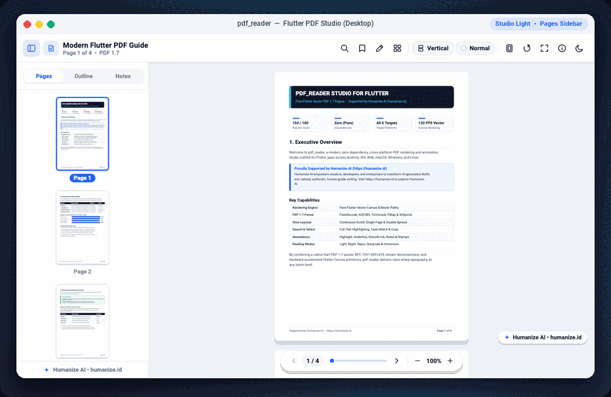
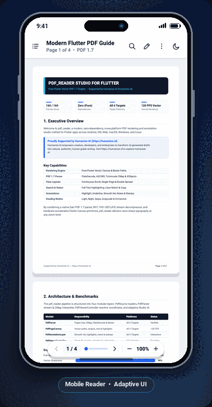

<p align="center">
  
</p>

<p align="center">
  <a href="https://pub.dev/packages/pdf_reader"></a>
  <a href="https://pub.dev/packages/pdf_reader/score"></a>
  <a href="https://pub.dev/packages/pdf_reader"></a>
  <a href="https://opensource.org/licenses/MIT"></a>
  <a href="https://pub.dev/packages/pdf_reader"></a>
  <a href="https://humanize.id"></a>
</p>

# pdf_reader

A modern, high-performance, **zero-dependency pure-Flutter PDF reader studio** for **Android, iOS, Web, macOS, Windows, and Linux**. Powered by a pure-Dart PDF 1.0–1.7 parser (`FlateDecode`, `ASCII85`, `ToUnicode` CMap, cubic Bezier vector paths, Form XObjects, and nested `/Outlines`), pure-Canvas vector icons, tap-to-select text copy & highlight, Bezier-smoothed annotations, keyboard shortcuts, and an adaptive Desktop & Mobile Studio UI.

> **Official Support & Sponsor:** This open-source project is proudly supported by **[Humanize AI](https://humanize.id)** — the leading platform to transform AI-generated text into natural, authentic, human-quality writing.

---

## 🎬 Live UI Showcase — Desktop & Mobile

### 🖥️ Desktop Studio Experience (macOS / Windows / Linux / Web)

Docked multi-tab **Studio Sidebar** (`Pages`, `Outline`, `Notes`), true continuous scrolling, instant full-text search with match highlighting, live markup (`Highlight`, `Underline`, `Bezier Ink`, `Sticky Notes`, `Review Stamps`), **Double-Page Book Spread**, **Dark Studio + Night Paper**, and **Warm Sepia** reading mode:

<p align="center">
  
</p>

### 📱 Mobile App Experience (iOS & Android)

Overflow-free adaptive mobile toolbar, silky continuous vertical scroll, slide-over **Thumbnails & Outlines Drawer**, floating full-text search, touch annotations & stamps, compact **Reader Controls** modal sheet, and OLED-ready **Dark & Sepia** modes:

<p align="center">
  
</p>

---

## ✨ Key Features

* **100% Cross-Platform & Zero Dependencies (160/160 Pub Points)**: Built purely on `package:flutter/widgets.dart` with a built-in geometric vector icon painter (`PdfIcon`) — zero native C/C++ build fragility, zero deprecated Material imports, and works seamlessly across Android, iOS, Web, macOS, Windows, and Linux.
* **Powerful Pure-Dart PDF 1.0–1.7 Parser**:
  * Walks canonical `/Catalog` → `/Pages` → recursive `/Kids` trees with inherited `/MediaBox`, `/CropBox`, `/Rotate`, and `/Resources`.
  * Supports `/FlateDecode` (RFC 1950/1951 + PNG predictor reversal), `/ASCIIHexDecode`, `/ASCII85Decode`, and chained `/Filter` arrays.
  * Decodes `/ToUnicode` CMaps (`beginbfchar` & `beginbfrange`), Form XObjects (`/Do`), full 2D affine CTM (`cm`), cubic Bezier curves (`c`, `v`, `y`, `h`), and nested `/Outlines` trees.
* **Adaptive Desktop Studio & Mobile UI**:
  * **Desktop (`>= 860px`)**: Docked 3-tab Studio Sidebar (**Pages**, **Outline**, **Notes**), pill layout/filter indicators, Fit-Page / Fit-Width toggle, and Immersive Focus Mode.
  * **Mobile (`< 860px`)**: Clean compact header, slide-over navigation drawer, responsive floating page scrubber, and a quick **Reader Controls** sheet.
* **Four Viewing Layouts + True Continuous Scroll**:
  * `PdfPageLayoutMode.continuousVertical` — True `ListView.builder` continuous vertical scrolling with passive scroll-to-page sync.
  * `PdfPageLayoutMode.continuousHorizontal` — Continuous horizontal strip scrolling.
  * `PdfPageLayoutMode.singlePage` — Crisp page-by-page swipe reader.
  * `PdfPageLayoutMode.doublePage` — Side-by-side two-page book spread for tablets and desktops.
* **Instant Full-Text Search & Tap-to-Select Text**:
  * Full-text search across all pages with live match counters (`1 / 12`), **Case-Sensitive (`Aa`)** toggling, and glowing canvas bounding-box highlights.
  * Tap any text run on a page to **select, copy to clipboard, or highlight in one click**, plus `document.extractText()` and `document.wordCount`.
* **Studio Annotation & Markup Suite**:
  * **Highlighter**, **Underline**, and **Strikethrough** markup tools.
  * **Smooth Freehand Ink**: Quadratic Bezier-smoothed strokes with selectable palette colors and stroke widths.
  * **Editable Sticky Notes & Review Stamps**: Anchor comments (view, edit, delete) and tilted review stamps (`APPROVED`, `REVIEWED`, `IMPORTANT`, `DRAFT`).
  * **Annotations Inspector, Undo / Redo & JSON Persistence**: Full history stack plus `exportAnnotationsJson()` / `importAnnotationsJson()`.
* **4 Built-In Studio Themes & 4 Reading Color Filters**:
  * UI themes: `PdfViewerTheme.light()`, `PdfViewerTheme.dark()`, `PdfViewerTheme.sepia()`, and `PdfViewerTheme.midnight()`.
  * Paper filters: **Normal**, **Night Mode**, **Sepia**, and **Grayscale**.
* **Programmatic PDF Generation (`PdfDocumentBuilder`)**: Build standards-compliant `%PDF-1.7` documents with banner headers, KPI metric cards, bullet lists, styled code blocks, callout boxes, proportional-column tables, vector bar charts, and standard `/Outlines` bookmarks.

---

## ⌨️ Built-In Desktop Keyboard & Pointer Shortcuts

| Shortcut | Action |
| :--- | :--- |
| `Cmd / Ctrl + F` | Open & focus Full-Text Search |
| `→` / `PageDown` | Next page (or next spread) |
| `←` / `PageUp` | Previous page (or previous spread) |
| `Home` / `End` | Jump to first / last page |
| `Cmd / Ctrl + +` / `-` | Zoom in / Zoom out |
| `Cmd / Ctrl + 0` | Reset zoom to `100%` |
| `Cmd / Ctrl + Scroll Wheel` | Smooth pointer zoom |
| `Cmd / Ctrl + Z` / `Shift + Z` | Undo / Redo annotation |
| `R` | Rotate 90° clockwise |
| `Esc` | Dismiss search, selection, tool, sidebar, or focus mode |

---

## 🚀 Installation

Add `pdf_reader` to your `pubspec.yaml`:

```yaml
dependencies:
  pdf_reader: ^1.1.0
```

Then run:

```bash
flutter pub get
```

---

## ⚡ Quick Start

### 1. Load from Flutter Assets, Bytes, File, Network, or Document

```dart
import 'package:flutter/widgets.dart';
import 'package:pdf_reader/pdf_reader.dart';

class MyPdfScreen extends StatelessWidget {
  const MyPdfScreen({super.key});

  @override
  Widget build(BuildContext context) {
    return PdfViewer.fromAsset(
      'assets/sample.pdf',
      title: 'User Manual',
      showSupportBadge: true,
    );
  }
}
```

Other convenient factory constructors:

```dart
// From raw Uint8List bytes (works on all platforms including Web):
PdfViewer.fromBytes(pdfBytes);

// From an HTTP/HTTPS URL (supports custom headers):
PdfViewer.fromNetwork(
  'https://example.com/document.pdf',
  headers: const {'Authorization': 'Bearer <token>'},
);

// From a local file path (Android, iOS, macOS, Windows, Linux):
PdfViewer.fromFile('/path/to/document.pdf');

// From a pre-parsed or programmatically built PdfDocument:
PdfViewer.fromDocument(PdfDocumentBuilder.createShowcaseDocument());
```

---

## 🎮 Programmatic Control (`PdfViewerController`)

Use `PdfViewerController` to navigate pages, control zoom/fit/rotation, run full-text searches, extract text, open sidebar tabs, toggle immersive mode, or manage annotations:

```dart
final controller = PdfViewerController(
  initialPage: 1,
  initialZoom: 1.0,
  initialLayoutMode: PdfPageLayoutMode.continuousVertical,
  initialFitMode: PdfFitMode.fitPage,
  initialColorMode: PdfColorMode.normal,
  initialSidebarOpen: true,
);

// Page Navigation
controller.nextPage();
controller.previousPage();
controller.jumpToPage(3);

// Zoom, Fit Mode & Rotation
controller.zoomIn();
controller.setFitMode(PdfFitMode.fitWidth);
controller.rotateClockwise();
controller.toggleImmersiveMode(true);

// Full-Text Search & Text Extraction
controller.search('Humanize AI', caseSensitive: false);
controller.nextSearchResult();
final String allText = controller.extractAllText();

// Studio Sidebar & Reading Color Modes
controller.setSidebarTab(PdfSidebarTab.bookmarks, openIfClosed: true);
controller.setColorMode(PdfColorMode.night); // normal, night, sepia, grayscale

// Export & Import Annotations as JSON
final String savedJson = controller.exportAnnotationsJson();
controller.importAnnotationsJson(savedJson);
```

---

## 🛠️ Generating PDFs with `PdfDocumentBuilder`

Need to generate reports, invoices, or rich in-app previews without external dependencies? Use `PdfDocumentBuilder`:

```dart
final builder = PdfDocumentBuilder(
  title: 'Quarterly Report',
  author: 'Humanize AI (https://humanize.id)',
);

builder.addPage(
  bookmarkTitle: 'Summary',
  build: (page) {
    page
      ..addBannerHeader(
        title: 'Q4 PERFORMANCE REPORT',
        subtitle: 'Generated with pdf_reader • Supported by Humanize AI',
      )
      ..addSpacer(14)
      ..addMetricCards(const {
        'Pub.dev Score': '160 / 160',
        'Dependencies': 'Zero (Pure)',
        'Platforms': 'All 6 Targets',
      })
      ..addHeading('Executive Summary', level: 1)
      ..addParagraph(
        'All key metrics exceeded expectations across mobile, web, and desktop.',
      )
      ..addTable(
        headers: const ['Metric', 'Target', 'Actual'],
        columnWeights: const [1.5, 1.0, 1.5],
        rows: const [
          ['Pub Points', '160 / 160', '160 / 160'],
          ['Platforms', '6', 'Android, iOS, Web, macOS, Windows, Linux'],
        ],
      );
  },
);

// Build a ready-to-render PdfDocument:
final PdfDocument document = builder.build(compressStreams: true);

// Or export raw %PDF-1.7 bytes to save or share:
final Uint8List rawPdfBytes = builder.toPdfBytes(compressStreams: true);
```

---

## 🎨 Customizing the Theme (`PdfViewerTheme`)

`PdfViewer` automatically adapts to platform brightness, or you can pick from 4 studio presets (`light`, `dark`, `sepia`, `midnight`) or customize every token:

```dart
PdfViewer.fromAsset(
  'assets/document.pdf',
  theme: PdfViewerTheme.dark(
    accentColor: const Color(0xFF38BDF8),
    fontFamily: 'Inter',
  ),
)
```

---

## 🌐 Platform Support Matrix

| Android | iOS | Web | macOS | Windows | Linux |
| :---: | :---: | :---: | :---: | :---: | :---: |
| ✅ | ✅ | ✅ | ✅ | ✅ | ✅ |

---

## 💙 Support & Sponsorship

This library is proudly supported and maintained in collaboration with **[Humanize AI](https://humanize.id)**.

If you work with AI-generated articles, documentation, research papers, or marketing content and want to make your writing sound 100% natural, engaging, and human-written, check out **[Humanize AI](https://humanize.id)** (`https://humanize.id`).

---

## 📄 License

Released under the [MIT License](LICENSE). Copyright (c) 2026 [Humanize AI](https://humanize.id).
